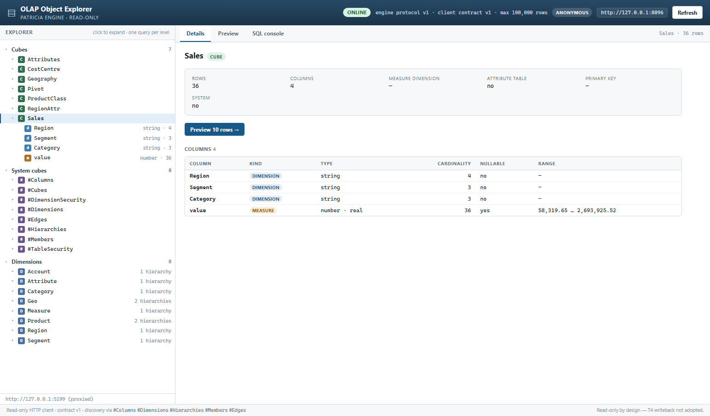
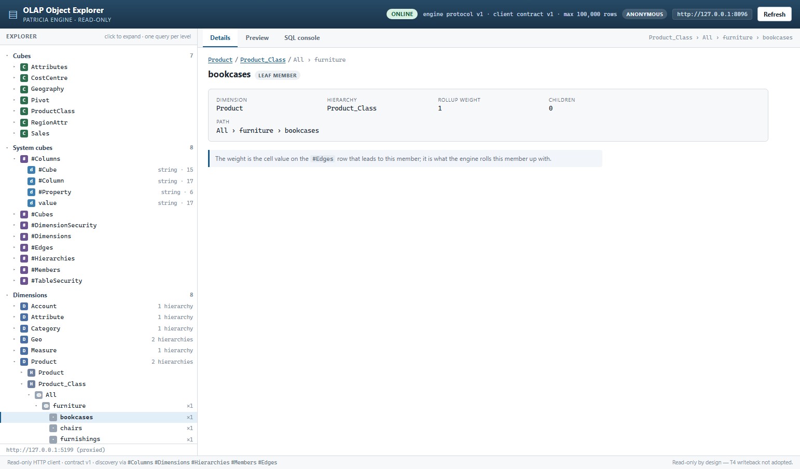
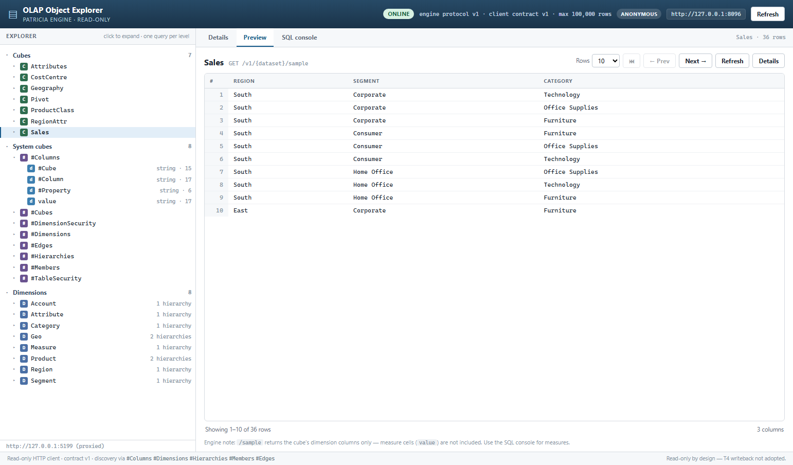
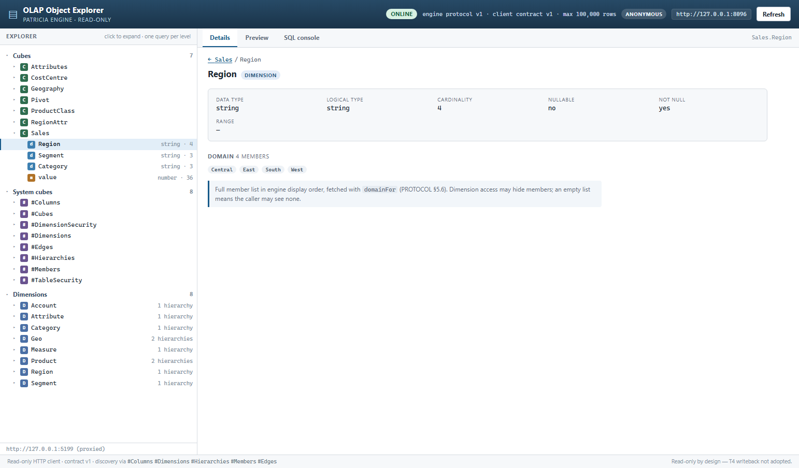
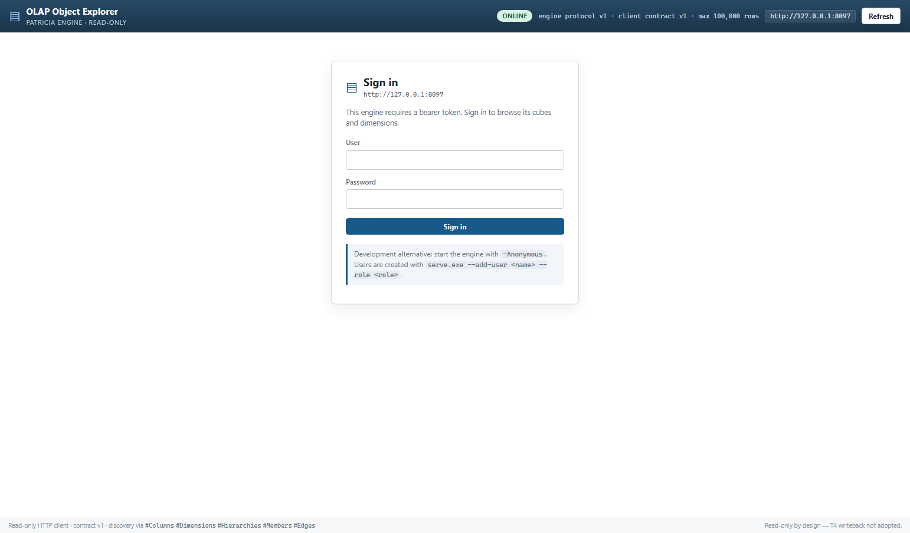
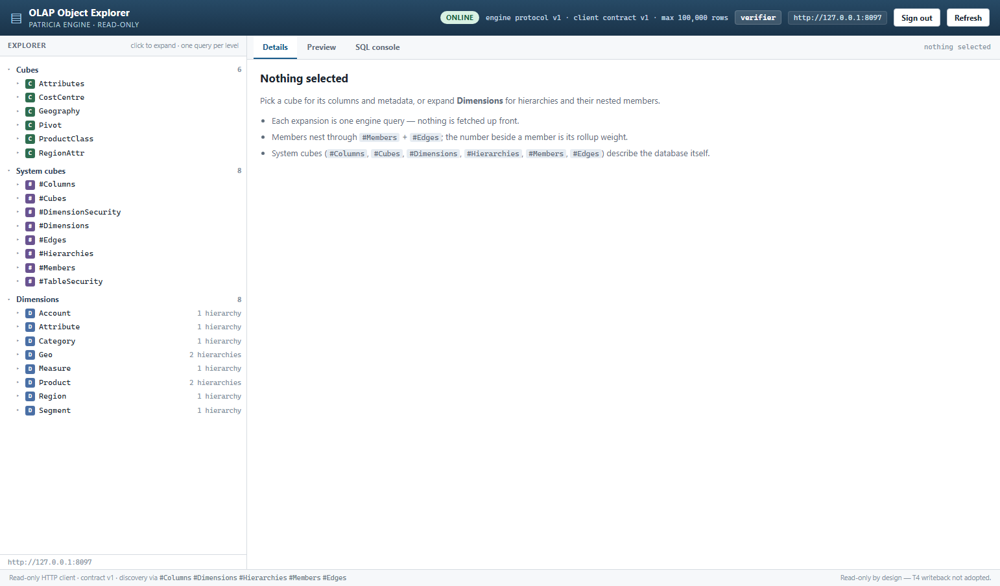

# OLAP Object Explorer

A standalone, **read-only** SSMS-style object browser for the **Patricia OLAP engine**
(HTTP API at `127.0.0.1:8080` by default; the engine is a separate project).

It answers *"what is in this database, and how is it structured?"* without the user
knowing any cube, dimension or hierarchy name in advance: cubes and their columns,
dimensions → hierarchies → members nested through the engine's edge table with rollup
weights, a details pane with member domains, a paged row preview, a SQL console, and — for
engines with authentication enabled — a sign-in form.

This client is **read-only by design**: it adopts the suite contract at tiers T0–T3 and
deliberately does not adopt T4 writeback (the engine *does* support writes — see
[Contract conformance](#contract-conformance)). Nothing in the engine tree is modified.



---

## Requirements

- **Node.js 20+** (the Windows `start.cmd` helper also finds the Node bundled with the
  DeepSeek Harness if `node` is not on PATH).
- **A running Patricia OLAP engine.** It is *not* part of this repository. Start it yourself,
  in its own terminal, and leave it open. `OLAP_ENGINE_URL` overrides the default
  `http://127.0.0.1:8080`.
- **Dependencies**: `pnpm install` (needs network the first time). `node_modules/` and the
  built `dist/` are local artifacts and are git-ignored.

## Quick start

```powershell
pnpm install
pnpm run build
pnpm run preview      # serves the built UI on http://127.0.0.1:5182
# or: pnpm run dev    # Vite dev server with live reload
# Windows convenience: start.cmd  (or start.cmd -Dev) — same thing, opens the browser
```

The engine's CORS is off by default (PROTOCOL §0.4), so the Vite dev/preview server proxies
`/v1` to the engine: the browser sees one origin and no `-Cors` restart is needed.

> Port: defaults to **5182**; `set PORT=<n>` before `start.cmd` overrides it.

If the engine enforces authentication — the engine source does, by default — the explorer
shows a sign-in form. Create a user once in the engine project (the security file is
`security.json` beside the engine's database):

```powershell
# from the engine repository
.\target\debug\serve.exe --add-user admin --role admin --password "<password>"
```

For development without auth, start the engine with its `-Anonymous` switch instead; the
explorer then opens directly and labels the engine "anonymous".

---

## Contract conformance

This client targets the suite contract **v1** (`protocolVersion 1`). The normative text is
`contract/PROTOCOL.md` in the workspace that owns the engine; it is deliberately **not
vendored** here (contract DECISIONS **D8** keeps `contract/` out of any tree for now), so the
pin lives in this README and in one code comment (`src/types.ts`).

| | |
| --- | --- |
| Pinned contract | **v1** == `protocolVersion 1` |
| Tiers claimed | **T0–T3** — T2 met under contract DECISIONS **D1** / PROTOCOL §1.4 (browser `sessionStorage` token) |
| T4 writeback | **not adopted by design** — the engine supports `POST /v1/{dataset}/write` and `POST /v1/save` (`capabilities.supportsWrite: true`); this product does not write |
| Verified against | engine **HEAD `33ae673`** (contract v1; wire pin `d6b02e0`), 2026-10-28 — later engine commits are additive/fix-only within v1 |
| Evidence | `pnpm run typecheck` exit 0; `pnpm run verify` **54/54 checks, exit 0** (see [Verification](#verification)) |

The client validates `capabilities.protocolVersion` before any data request and shows a
blocking **"Unsupported contract version"** state on a mismatch (PROTOCOL §0.3/§12): a v2
engine could change field meanings, so "try anyway" is exactly the silent-wrong-answer
failure mode the contract forbids. Member identity is matched case-insensitively while
labels keep the casing each endpoint returned (the reference database currently returns
`#Members` lowercased but `#Edges`/query values in original casing — reported as a finding).

---

## What the tree shows

| Level | Source | Notes |
| --- | --- | --- |
| Root | `GET /v1/datasets` | split into **Cubes** and **System cubes** by the `#` prefix (the reference database currently lists 7 user + 8 system cubes, including the `#TableSecurity`/`#DimensionSecurity` control cubes) |
| Cube → columns | `GET /v1/{cube}` (describe) | kind, type, cardinality, nullable, min/max |
| Dimensions | `#Dimensions` | 8 dimensions, each with its hierarchy count |
| Dimension → hierarchies | `#Hierarchies` | e.g. `Product` → `Product`, `Product_Class` |
| Hierarchy → members | `#Members` + `#Edges`, folded client-side | nested parent/child, rollup weight shown as `×1` |
| Dimension column → domain | `POST /v1/{dataset}/query` with `domainFor` | full member list in engine display order (PROTOCOL §5.6) |

Every level is lazy: expanding a row issues the one query it needs. Expanding the same row
again does not hit the engine (promise-level cache; **Refresh** clears it).

Member nesting is a client-side fold (`src/memberTree.ts`): roots are members that never
appear as an edge child, "All" sorts first, then natural order (`Item 2` before `Item 10`).
Member **identity is case-insensitive** (the engine dictionary is), so a saved database whose
`#Members` and `#Edges` disagree on casing still folds into one tree; labels keep the
`#Members` casing. A member with several parents (a shared rollup) appears under each parent;
weights of `0.5` are preserved and unit-tested. Cycles and self-edges cannot hang the renderer.



## Panels

- **Details** — cube metadata (`rowCount`, `measureDimension`, `isAttributeTable`,
  `primaryKey`, `isSystem`) plus a columns table; column, dimension, hierarchy and member
  views with breadcrumbs. Selecting a dimension column appends its **Domain**: the full
  member list in engine display order, fetched with `domainFor` (PROTOCOL §5.6) and gated on
  `capabilities.supportsInlineDomain`. Member view shows the full path, children and rollup
  weight.
- **Preview** — paged `sample` grid (10/25/50/100 rows, prev/next/first, nulls shown as
  `null`). `sample` returns stored leaf rows for the cube's dimension columns; the implicit
  measure `value` column is not part of it (PROTOCOL §4), and the pane says so — use the SQL
  console or the query API for measures.
- **SQL console** — `POST /v1/sql` passthrough rendered as the engine's formatted text
  table; Ctrl+Enter runs. The contract classes this as engine tooling, not a data path
  (PROTOCOL §0.5), and two known engine gaps are stated in the pane (§11.6 `GROUP`/`HAVING`
  parsed-but-unread, §11.7 `COUNT` over text): unnamed dimensions also default to their first
  member on this path, so name every dimension you care about.




## Sign in

When `GET /v1/capabilities` reports `authRequired: true`, the shell is replaced by a login
form. It POSTs to `/v1/login`, keeps the token in `sessionStorage` (per tab, never written
to disk), shows the user in the header, and offers **Sign out**. Engine sessions live in
memory, so a restart or the 12-hour expiry invalidates the token: the next request 401s and
the form returns with a "session expired" note instead of a tree full of errors. Stale
tokens against an `-Anonymous` engine are detected and cleared (no dead-end login screen).

`?token=<token>` still works for scripted access: it is moved into sessionStorage and
stripped from the address bar. Anonymous engines never show the form. Token storage follows
contract DECISIONS **D1** / PROTOCOL **§1.4**: memory or `sessionStorage` only, never
`localStorage`, a URL, a log or the UI, and the token is dropped on any 401.

If the engine reports a different `protocolVersion`, the sign-in flow is preceded by a
blocking **Unsupported contract version** screen (no data requests are sent).




---

## How it works

- **`src/api.ts`** — typed fetch client. Percent-encodes every dataset path segment
  (`#Members` → `%23Members`, PROTOCOL §0.2), maps engine errors to an `EngineError` carrying
  `status`, `code` and `error`, and surfaces both in the UI. Pins
  `SUPPORTED_PROTOCOL_VERSION = 1`; every query body carries it.
- **`src/auth.ts`** — token/session state (`sessionStorage` + memory), `?token=` seeding,
  sign-out, and the single "session expired" path taken when any request 401s.
- **`src/login.tsx`** — the sign-in form; `POST /v1/login` failures are shown verbatim.
- **`src/discovery.ts`** — the system cubes, one query per level, promise-cached. Structural
  reads always use `POST /v1/{dataset}/query`, never the SQL console. It also owns the
  pure-domain request behind the details pane's member lists (`domainFor`, §5.6).
- **`src/memberTree.ts`** — pure fold from members + edges to a forest, with case-insensitive
  member identity. No imports, no I/O, unit-tested directly (including empty input and mixed
  casing).
- **`src/tree.tsx` / `details.tsx` / `preview.tsx` / `sql.tsx` / `App.tsx`** — UI. `App.tsx`
  owns the contract pin (`protocolVersion` guard), the auth gate and the shell state.
- **`src/data.ts`** — barrel entry for the data layer. If this ever folds into Plateau,
  this (plus `api`/`discovery`/`memberTree`/`auth`) is the piece to lift; the React UI is
  the standalone shell.
- **`tools/verify.mjs`** — the end-to-end check described below.

Two URL parameters are supported:

| Parameter | Effect |
| --- | --- |
| `?engine=http://127.0.0.1:8090` | talk to a different engine directly (needs `-Cors` on it) |
| `?token=<bearer token>` | send `Authorization: Bearer …`; seeded into the session, then removed from the URL |

Default behaviour (no parameters) is same-origin through the Vite proxy, with CORS off.

---

## Verification

`tools/verify.mjs` is a self-contained harness. It spawns and kills its own children — the
Vite preview server (5199), headless Chrome, and engine processes: an anonymous one (8096)
when no engine answers at `OLAP_ENGINE_URL`, an auth-enabled one (8097) for the auth phase,
and a tiny `protocolVersion: 2` stub (8098) for the version guard. It leaves nothing running.

```powershell
pnpm run verify
```

Environment overrides (all optional; workspace defaults shown):

| Variable | Default | Used for |
| --- | --- | --- |
| `OLAP_ENGINE_URL` | `http://127.0.0.1:8080` | live engine for the data/UI phases |
| `OLAP_ENGINE_BIN` | `../olap-target-verify/debug/serve.exe`, `../Patricia/olap_engine/target/debug/deps/serve.exe`, `../Patricia/olap_engine/target/debug/serve.exe` | engine binary for the spawned anonymous + auth instances |
| `OLAP_ENGINE_DB` | `../Patricia/olap_engine/database.bin` | copied (never loaded in place) for spawned engines |
| `VERIFY_PORT`, `VERIFY_ANON_PORT`, `VERIFY_AUTH_PORT`, `VERIFY_STUB_PORT`, `VERIFY_CDP_PORT` | 5199 / 8096 / 8097 / 8098 / 9333 | port overrides |
| `CHROME_PATH` | auto-detected Chrome/Edge | headless browser |

When no engine binary/reference database is available, phases 3–5 report a skip and phases
1–2 still run, so a plain clone gets build + unit coverage.

Five phases, **54 checks, all green** (2026-10-28, engine HEAD `33ae673`):

1. `tsc --noEmit` and a production `vite build`.
2. Unit tests for the member fold: empty input, flat hierarchies, nesting, "All" ordering,
   natural sort, shared rollup with weight 0.5, cycles/self-edges, path flattening, and
   case-insensitive identity with mixed `#Members`/`#Edges` casing.
3. Contract + live data checks using the app's own `src/data.ts`: the pinned protocol version
   and its refusal of v2; capabilities; datasets split; `Sales` 36 rows; 8 dimensions;
   `Product` two hierarchies; `Product_Class` folds to `All → Furniture → Bookcases`; flat
   hierarchies; sample shape; SQL passthrough; the `domainFor` pure-domain form plus the loud
   `invalid_argument` for an unknown field; 404 `unknown_dataset`; empty input.
4. Headless-Chrome walkthrough of the anonymous engine: no login form, select `Sales`, expand
   columns, open a dimension column's **Domain**, expand `#Columns`, read preview rows, expand
   `Product → Product_Class → All → Furniture → Bookcases` (case-insensitive assertions,
   weight `×1`, member details), run SQL, confirm a clean console, assert the offline banner
   for an unreachable engine, and assert a **protocolVersion 2 stub** is blocked before any
   data request (only `/v1/capabilities` is hit).
5. Authentication against a real engine with auth enabled on a **copy** of `database.bin`:
   public capabilities with `authRequired: true`, 401s without a token, wrong-password 401,
   login token/roles, authenticated discovery, clearing the token 401s; in the browser the
   login form replaces the shell, the engine's error is shown verbatim, sign-in loads the tree
   with the header user, reload keeps the session, Sign out returns to the form, and an engine
   restart mid-session produces the "session expired" re-login.

Screenshots: `01`–`05` anonymous walkthrough, `06`–`08` auth phase, `09-domain-values.png`,
`10-unsupported-version.png`.

### Acceptance criteria (engine handoff + contract adoption)

| Criterion | Covered by |
| --- | --- |
| `Sales` shows dimensions Region/Segment/Category | data check + walkthrough |
| `Product` shows two hierarchies (`Product`, `Product_Class`) | data check + walkthrough |
| `Product_Class` nests `All → Furniture → Bookcases` | data check + walkthrough (case-insensitive labels) |
| A member's weight is visible | `×1` in the tree, "Rollup weight 1" in details |
| A fresh/empty database renders (0 rows, no crash) | unit test for empty input; empty-state branches |
| No 404s on system-cube paths | `%23Members` query + describe of `#Columns` |
| Contract pin + `protocolVersion` validation | pinned-v1 unit check + v2 stub UI guard |
| `domainFor` exercised (T1 clause) | data checks + Domain pane + unknown-field error |
| T2 auth under D1 | token is memory/`sessionStorage`; auth phase above |
| Read-only by design (T4 not adopted) | only GET + `query`/`sql` POSTs are issued |

A truly empty database was not pointed at live (that needs a separate engine instance). The
folding is tested on empty input and the UI has explicit 0-row/empty states.

---

## Findings about the engine (report only — nothing patched)

Read-only observations from building and verifying this client; the engine/contract sessions
own the fixes. Contract section numbers refer to `contract/PROTOCOL.md` (§11 = open breaks).

1. **Member casing is inconsistent across the wire, and the reference database shows it.**
   At engine HEAD `33ae673` with the current `database.bin`, `#Members` returns lowercased
   names (`central`, `furniture`, `bookcases`, …) while `#Edges` parent references and
   `query`/`domainFor` cells return the registered casing (`Furniture`, `Central`). A
   case-sensitive fold tears `Product_Class` into four roots. The client now matches member
   identity case-insensitively (unit-tested) and displays `#Members` casing; the engine
   should return one casing everywhere. The contract has no member-casing rule to cite,
   unlike `/v1/datasets` (§2, “exact stored casing”).
2. **Authentication/security postdate the original handoff.** Engine HEAD `33ae673` has
   `POST /v1/login`, bearer tokens, `capabilities.authRequired` (`true` by default, `false`
   under `--allow-anonymous`) and the `#TableSecurity`/`#DimensionSecurity` control cubes.
   `olap-object-explorer-handoff.md` §2/§3 predates all of it. The client feature-detects
   auth and handles anonymous, login-required and expired-session states.
3. **`/sample` returns dimension columns only, and that is contractual.** PROTOCOL §4 defines
   `sample` as stored leaf rows for the cube's dimension columns; the implicit measure
   `value` is not included. The preview shows what the engine returns and says so — measures
   come from `POST query` or the SQL console. Not a defect.
4. **`#Columns` describe includes a trailing `value` column** — documented by PROTOCOL §3.3
   (implicit `value` for measure-less cubes). The UI renders all 4 columns.
5. **`#Cubes` properties need a second grouping.** A `#Cubes` query grouped only by `#Cube`
   returns the cube with a `value` cell; `measureDimension`/`isAttributeTable` appear only
   when grouping by `#Cube` **and** `#Property`. The client sidesteps this via `describe`.
6. **`Product` is flat (`16` leaves, no `All`), `Product_Class` is nested** (`20` members,
   `19` edges, `All` root) — correct in the reference database; both render correctly.
7. **CORS is off by default** (§0.4) and the proxy route works; the client also supports a
   CORS-enabled direct `?engine=` mode.
8. **SQL tooling gaps are real** — default-member injection plus §11.6 (`GROUP BY`/`HAVING`
   parsed-but-unread) and §11.7 (`COUNT` over text returns the last text). The console states
   both gaps in the UI; the tree/details never depend on the SQL surface (§0.5).
9. **`Account` is a deliberately “mixed” dimension — and its seed import silently loses
   relations.** `examples/Plateau/seed.sql` §7 calls CostCentre's `Account` dimension “the
   mixed Total tree … its members span what are, elsewhere, two different dimensions”, so the
   members really are named `Region: …` / `Category: …` and the client renders them faithfully.
   The defect: `examples/Plateau/hierarchy-parent-child.csv` declares **16** parent-child rows
   (each `Category:` child under all four Regions) but `#Edges` stores only **7** — the engine
   enforces one-parent-per-hierarchy (`src/dimension/hierarchy.rs` `link`, “one-parent rule”)
   and re-parents repeated children, while `.import_pc` (`src/main.rs`) discards the returned
   old parent instead of warning like `.rollup` does. Nine declared relations vanish and the
   `Category:` accounts end up only under `Region: South` (the last CSV block). Either
   `.import_pc` should report re-parenting or the seed should encode a real tree.
10. **System cubes can lag after HTTP writes** (§11.5): the structure tree reads `#Cubes`/
   `#Members`/`#Edges`, so after *another* writer's HTTP writes the tree may be stale until a
   catalogue reload — user-cube reads are always current.

---

## Decisions and open questions

- **Measure-aware preview — not needed (decided).** The Preview keeps showing raw `/sample`
  rows. Showing measure values without the aggregation context they belong to is noise in an
  object browser, and the contract keeps T4/measure-grid work out of the required surface.
  The SQL console remains the path when you need numbers.
- **Ownership — stays standalone (decided).** If it ever folds into Plateau, `src/data.ts` is
  the boundary to lift; nothing is being built for that now.
- **Anything else for v1.1?** Candidates: tree filter/search, remembering expansion across
  reloads. None of it is needed to close v1.

## Deliberately not done (v1)

- **T4 writeback.** The engine supports `POST /v1/{dataset}/write` and `POST /v1/save`
  (`capabilities.supportsWrite: true`); this product is read-only by design and offers no
  edit/save affordance.
- No measure-aware grid in the Preview: measures without aggregation context are noise
  (decided with the user).
- No tree filter/search; no persisted expansion/selection; no virtualisation. Structural
  queries request up to `capabilities.maxRows` (100000) and surface an in-tree note if the
  engine truncates a response.
- No multi-engine switcher UI (only the `?engine=` parameter).
- No "remember me": the token is per-tab `sessionStorage`, deliberately not persisted to disk.
- The SQL console renders the engine's text output; it does not parse SQL into a grid.

---

## Environment notes

- **Separate project.** This repository is a pure HTTP client: it never imports engine code,
  and the engine/Plateau trees were only read and queried while building it. Everything the
  app needs is in this folder; only the verification tool has optional external paths (see
  the environment table under Verification).
- **No self-started servers in normal use.** `start.cmd`/`pnpm run dev` are for *your*
  terminal. `tools/verify.mjs` starts its helpers as children of a single test run and kills
  them before exiting: a Vite preview server, headless Chrome, and engine processes —
  anonymous (8096) if no engine is running, auth-enabled (8097) for the auth phase, and a
  tiny version stub (8098). All engine processes use throwaway `database.bin` copies under
  `.verify/`; the reference is never loaded in place.
- **Creating users for an auth-enabled engine.** The engine's security file defaults to
  `security.json` beside the database. Create users once with
  `serve.exe --add-user <name> --role <role> --password <password>` (or use the engine's
  `-Anonymous` switch for development). `--list-users` prints what exists.
- **Dependency install in this checkout.** `node_modules` was populated offline from a local
  pnpm store, so `package.json` has no lockfile here. `pnpm-workspace.yaml` records the two
  pnpm 11 settings needed on Windows — `nodeLinker: hoisted` (pnpm's junction links otherwise
  break Node resolution) and `allowBuilds: esbuild: true` — and `.npmrc` repeats the linker
  note for older pnpm. On a fresh clone: `pnpm install` (network) then `pnpm run build`.
- **Verification needs looser process permissions when run inside a sandbox.** The build
  toolchain (esbuild) and the browser walkthrough spawn child processes with piped stdio,
  which a file/process sandbox can block. Nothing outside this folder (apart from reading the
  engine's `database.bin` to make throwaway copies) is touched by it.
