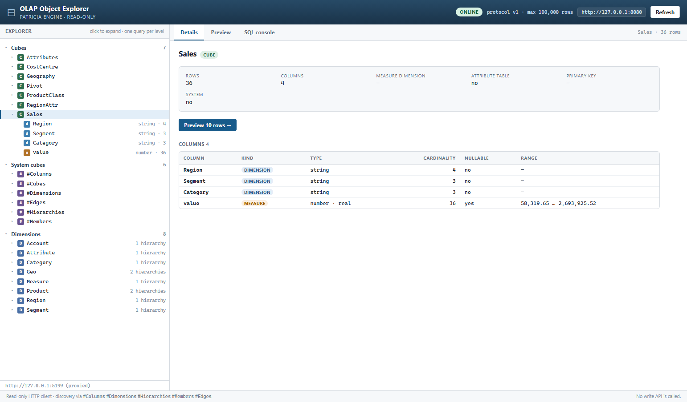
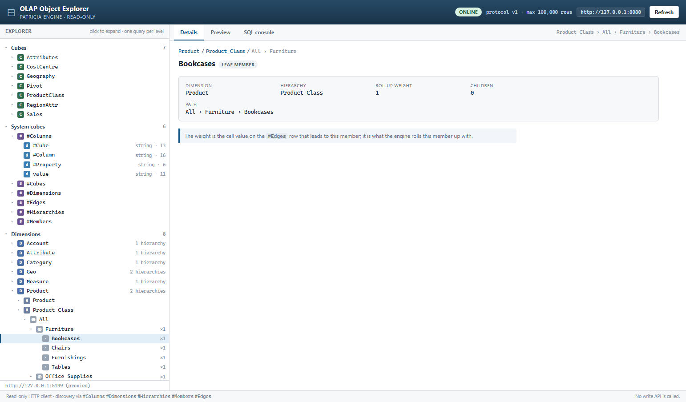
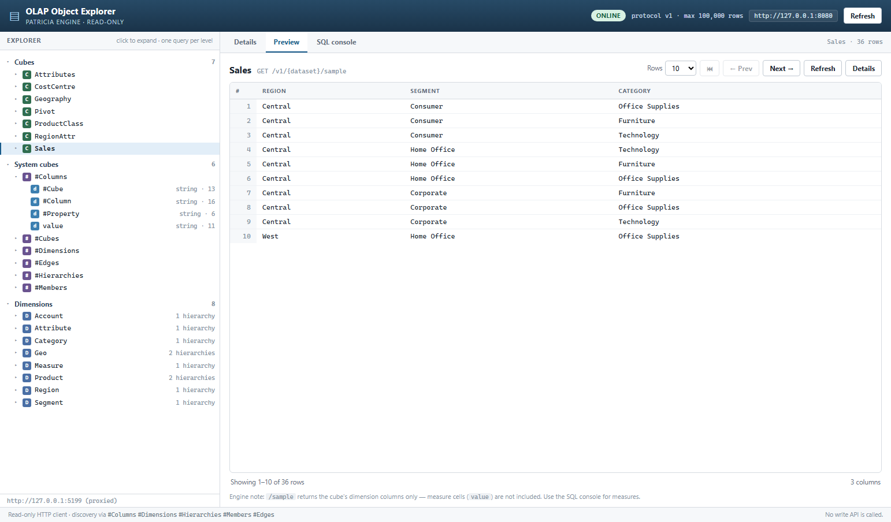
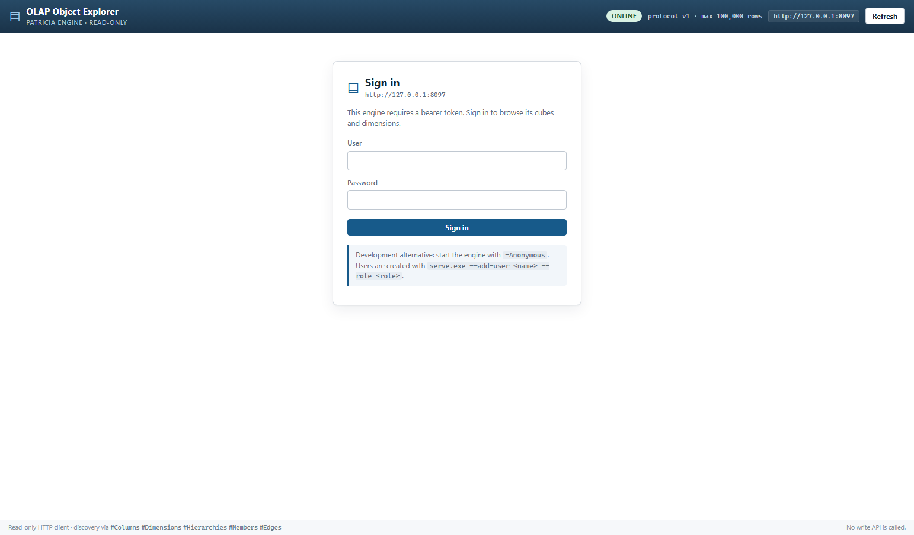
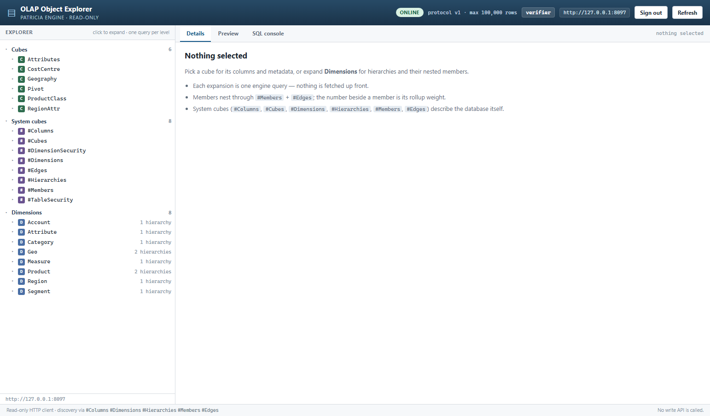

# OLAP Object Explorer

A standalone, **read-only** SSMS-style object browser for the **Patricia OLAP engine**
(HTTP API at `127.0.0.1:8080` by default; the engine is a separate project).

It answers *"what is in this database, and how is it structured?"* without the user
knowing any cube, dimension or hierarchy name in advance: cubes and their columns,
dimensions → hierarchies → members nested through the engine's edge table with rollup
weights, a details pane, a paged row preview, a SQL console, and — for engines with
authentication enabled — a sign-in form.

Nothing in the engine is modified, and nothing is ever written: the engine has no write
API (handoff §5.9) and this client only reads.



---

## Requirements

- **Node.js 20+** (the Windows `start.cmd` helper also finds the Node bundled with the
  DeepSeek Harness if `node` is not on PATH).
- **A running Patricia OLAP engine.** It is *not* part of this repository. Start it yourself,
  in its own terminal, and leave it open. `OLAP_ENGINE_URL` overrides the default
  `http://127.0.0.1:8080`.
- **Dependencies**: `pnpm install` (needs network the first time). `node_modules/` and the
  built `dist/` are local artifacts and are git-ignored.

## Quick start

```powershell
pnpm install
pnpm run build
pnpm run preview      # serves the built UI on http://127.0.0.1:5182
# or: pnpm run dev    # Vite dev server with live reload
# Windows convenience: start.cmd  (or start.cmd -Dev) — same thing, opens the browser
```

The engine's CORS is off by default (handoff §2), so the Vite dev/preview server proxies
`/v1` to the engine: the browser sees one origin and no `-Cors` restart is needed.

> Port: defaults to **5182**; `set PORT=<n>` before `start.cmd` overrides it.

If the engine enforces authentication — the engine source does, by default — the explorer
shows a sign-in form. Create a user once in the engine project (the security file is
`security.json` beside the engine's database):

```powershell
# from the engine repository
.\target\debug\serve.exe --add-user admin --role admin --password "<password>"
```

For development without auth, start the engine with its `-Anonymous` switch instead; the
explorer then opens directly and labels the engine "anonymous".

---

## What the tree shows

| Level | Source | Notes |
| --- | --- | --- |
| Root | `GET /v1/datasets` | split into **Cubes** (7) and **System cubes** (6) |
| Cube → columns | `GET /v1/{cube}` (describe) | kind, type, cardinality, nullable, min/max |
| Dimensions | `#Dimensions` | 8 dimensions, each with its hierarchy count |
| Dimension → hierarchies | `#Hierarchies` | e.g. `Product` → `Product`, `Product_Class` |
| Hierarchy → members | `#Members` + `#Edges`, folded client-side | nested parent/child, rollup weight shown as `×1` |

Every level is lazy: expanding a row issues the one query it needs. Expanding the same row
again does not hit the engine (promise-level cache; **Refresh** clears it).

Member nesting is a client-side fold (`src/memberTree.ts`): roots are members that never
appear as an edge child, "All" sorts first, then natural order (`Item 2` before `Item 10`).
A member with several parents (a shared rollup) appears under each parent; weights of
`0.5` are preserved and unit-tested. Cycles and self-edges cannot hang the renderer.



## Panels

- **Details** — cube metadata (`rowCount`, `measureDimension`, `isAttributeTable`,
  `primaryKey`, `isSystem`) plus a columns table; column, dimension, hierarchy and member
  views with breadcrumbs. Member view shows the full path, children and rollup weight.
- **Preview** — paged `sample` grid (10/25/50/100 rows, prev/next/first, nulls shown as
  `null`). See the [finding about `/sample`](#findings-about-the-engine-report-only).
- **SQL console** — `POST /v1/sql` passthrough rendered as the engine's formatted text
  table; Ctrl+Enter runs. This is the engine's SQL path, so its quirks are the engine's:
  unnamed dimensions default to their first member (see the in-app note; handoff §5.5).



## Sign in

When `GET /v1/capabilities` reports `authRequired: true`, the shell is replaced by a login
form. It POSTs to `/v1/login`, keeps the token in `sessionStorage` (per tab, never written
to disk), shows the user in the header, and offers **Sign out**. Engine sessions live in
memory, so a restart or the 12-hour expiry invalidates the token: the next request 401s and
the form returns with a "session expired" note instead of a tree full of errors. Stale
tokens against an `-Anonymous` engine are detected and cleared (no dead-end login screen).

`?token=<token>` still works for scripted access: it is moved into sessionStorage and
stripped from the address bar. Anonymous engines never show the form.




---

## How it works

- **`src/api.ts`** — typed fetch client. Percent-encodes every dataset path segment
  (`#Members` → `%23Members`, handoff §5.1), maps engine errors to an `EngineError`
  carrying `status`, `code` and `error`, and surfaces both in the UI.
- **`src/auth.ts`** — token/session state (`sessionStorage` + memory), `?token=` seeding,
  sign-out, and the single "session expired" path taken when any request 401s.
- **`src/login.tsx`** — the sign-in form; `POST /v1/login` failures are shown verbatim.
- **`src/discovery.ts`** — the six system cubes, one query per level, promise-cached.
  Structural reads always use `POST /v1/{dataset}/query`, never the SQL console, because
  the SQL path injects default members (handoff §5.5).
- **`src/memberTree.ts`** — pure fold from members + edges to a forest. No imports, no
  I/O, unit-tested directly (including empty input).
- **`src/tree.tsx` / `details.tsx` / `preview.tsx` / `sql.tsx` / `App.tsx`** — UI.
- **`src/data.ts`** — barrel entry for the data layer. If this ever folds into Plateau,
  this (plus `api`/`discovery`/`memberTree`/`auth`) is the piece to lift; the React UI is
  the standalone shell.
- **`tools/verify.mjs`** — the end-to-end check described below.

Two URL parameters are supported:

| Parameter | Effect |
| --- | --- |
| `?engine=http://127.0.0.1:8090` | talk to a different engine directly (needs `-Cors` on it) |
| `?token=<bearer token>` | send `Authorization: Bearer …`; seeded into the session, then removed from the URL |

Default behaviour (no parameters) is same-origin through the Vite proxy, with CORS off.

---

## Verification

`tools/verify.mjs` is a self-contained harness. It spawns and kills its own children (a
Vite preview server on 5199, headless Chrome, and for the auth phase a second engine
instance on 8097 against a throwaway database copy); it leaves no server running. Run it
with the engine up:

```powershell
pnpm run verify
```

It needs the engine's HTTP API at `OLAP_ENGINE_URL` (default 8080) and uses two optional
external paths, both overridable by environment variable:

| Variable | Default (workspace layout) | Used for |
| --- | --- | --- |
| `OLAP_ENGINE_BIN` | `../olap-target-verify/debug/serve.exe` or `../Patricia/olap_engine/target/debug/deps/serve.exe` | a build that has `POST /v1/login` — runs the auth phase |
| `OLAP_ENGINE_DB` | `../Patricia/olap_engine/database.bin` | copied (never loaded in place) so the spare engine has data |

When neither is available the auth phases are **skipped with a message**, not failed, so the
build/data/UI phases still run in a plain clone. Phases 3–5 need a live engine; phases 1–2
(and the build) do not.

Five phases, **48 checks, all green** against the seeded database (35 when the auth phase is
skipped):

1. `tsc --noEmit` and a production `vite build`.
2. Unit tests for the member fold: empty input, flat hierarchies, nesting, "All" ordering,
   natural sort, shared rollup with weight 0.5, cycles/self-edges, path flattening.
3. Live data checks using the app's own `src/data.ts` (bundled with esbuild, run from Node
   against 8080): datasets split, `Sales` has 36 rows, 8 dimensions with counts, `Product`
   has exactly `Product`+`Product_Class`, `Product_Class` folds to
   `All → Furniture → Bookcases`, flat `Product`/`Region` render as roots, sample shape,
   SQL passthrough, and a 404 `unknown_dataset` surfacing correctly.
4. A headless-Chrome walkthrough of the **anonymous** engine over CDP: no login form, click
   `Sales`, expand its columns, expand `#Columns`, read 10 preview rows, expand `Product` →
   `Product_Class` → `All` → `Furniture` → `Bookcases`, assert `×1` and the member details
   (path + rollup weight), run a SQL statement, assert no page/console errors, and navigate
   to an unreachable engine to assert the offline banner instead of a crash.
5. **Authentication against a real engine with auth enabled.** When the 8080 binary predates
   auth, the harness runs an already-built auth-capable `serve.exe` on port 8097 against a
   **copy** of `database.bin` (under `.verify/`; the reference is never loaded by the server),
   creates a throwaway user with `--add-user`, and checks the contract plus the UI:
   capabilities is public with `authRequired: true`; data routes 401 without a token; a wrong
   password 401s; login returns a 64-hex token and roles; the token unlocks discovery; clearing
   it 401s. In the browser: the login form replaces the shell, a wrong password shows the
   engine's message, a correct one loads the tree and header user, a reload keeps the session,
   Sign out returns to the form, and **restarting the engine mid-session** produces the
   "session expired" re-login rather than a broken tree.

Screenshots: `01`–`05` from the anonymous walkthrough, `06`–`08` from the auth phase
(`06-login.png`, `07-authenticated.png`, `08-session-expired.png`).

### Acceptance criteria from the handoff

| Criterion | Covered by |
| --- | --- |
| `Sales` shows dimensions Region/Segment/Category | data check + browser walkthrough |
| `Product` shows two hierarchies (`Product`, `Product_Class`) | data check + walkthrough |
| `Product_Class` nests `All → Furniture → Bookcases` | data check + walkthrough |
| A member's weight is visible | `×1` in the tree, "Rollup weight 1" in details |
| A fresh/empty database renders (0 rows, no crash) | unit test for empty input; empty-state branches in the UI |
| No 404s on system-cube paths | data check (`%23Members` query, describe of `#Columns`) |
| The explorer never writes | only GET + `query`/`sql` POSTs are issued; by construction |

A truly empty database was not pointed at live (that needs another engine instance). The
folding is tested on empty input and the UI has explicit 0-row/empty states.

---

## Findings about the engine (report only — nothing patched)

These are the places where the running engine and/or the handoff differ from what I found
while building. All are read-only observations; the engine session owns the fixes.

1. **Authentication is newer than the running binary, and the handoff does not mention it.**
   `Patricia/olap_engine` at HEAD `afc235c` ("fix(auth): capabilities is PUBLIC…") implements
   `POST /v1/login`, bearer tokens and `capabilities.authRequired`; `start-engine.ps1` says
   authentication is required by default since the S1 security work and offers `-Anonymous`
   for development. The **running 8080 instance predates this** (built 2026-10-22): it has no
   `/v1/login` (returns `Unknown operation '' for dataset 'login'`), its `capabilities` has no
   `authRequired`, and it serves anonymously. A post-auth binary *does* exist on disk
   (`olap-target-verify/debug/serve.exe`, 23 Oct, and `target/debug/deps/serve.exe`) and was
   used to verify the login flow against the real contract. Consequence of a rebuild: plain
   `start-engine.cmd` will need users created with `serve.exe --add-user`, or `-Anonymous`.
   The explorer handles all three states: anonymous, login required, session expired.
2. **`GET /v1/{dataset}/sample` omits the measure (`value`) column.** For `Sales`, describe
   reports `Region, Segment, Category, value` but sample returns only
   `["Region","Segment","Category"]` (3 columns, 3 cells/row) — verified across `Sales`,
   `Pivot`, `Attributes`, `#Columns`. Cubes with a measure dimension still include the
   measure *dimension* column (e.g. `Geography` → `["Geo","Measure"]`), but never the fact
   `value`. The preview shows what the engine returns and states this in the pane; for
   measure values the SQL console is the working path. Worth either fixing in `/sample` or
   documenting, because a data preview without measures is half a preview.
2. **`GET /v1/{dataset}/sample` omits the measure (`value`) column.** For `Sales`, describe
   reports `Region, Segment, Category, value` but sample returns only
   `["Region","Segment","Category"]` (3 columns, 3 cells/row) — verified across `Sales`,
   `Pivot`, `Attributes`, `#Columns`. Cubes with a measure dimension still include the
   measure *dimension* column (e.g. `Geography` → `["Geo","Measure"]`), but never the fact
   `value`. The preview shows what the engine returns and states this in the pane; for
   measure values the SQL console is the working path. Worth either fixing in `/sample` or
   documenting, because a data preview without measures is half a preview.
3. **`describe` on a system cube includes a trailing `value` column.** Handoff §4 lists
   `#Columns` as 3 columns; `GET /v1/%23Columns` returns 4 (`…, "value"`). Not harmful —
   the UI renders what describe returns — but the doc should say 4.
4. **`#Cubes` properties need a second grouping.** A `#Cubes` query grouped only by `#Cube`
   returns the cube with a `value` cell; `measureDimension`/`isAttributeTable` appear only
   when grouping by `#Cube` **and** `#Property`. The explorer sidesteps this because
   `describe` already carries both fields, so `#Cubes` as a dataset is currently unused.
5. **`Product` is a flat hierarchy, `Product_Class` is the nested one.** `Product` has 16
   leaf members and no edges (no `All` root); `Product_Class` has 20 members (16 leaves +
   `All` + 3 aggregates) and 19 edges. The handoff's "20 rows" is correct for
   `Product_Class`; both render correctly (a flat hierarchy is just a sorted list of roots).
6. **CORS is off**, confirmed: `GET /v1/datasets` with an `Origin` header returns no
   `Access-Control-Allow-Origin`. The proxy route works as recommended.
7. **The SQL default-member gotcha is real and visible.** `SELECT Region, value FROM Sales`
   in the SQL console returns the small default-member subset (`Central 431092.09 …`), not
   the full `POST query` totals (`Central 6436941.57 …`). The console carries an in-app note.
8. **`Account` is a deliberately "mixed" dimension — and its seed import silently loses
   relations.** `examples/Plateau/seed.sql` §7 calls CostCentre's `Account` dimension "the
   mixed Total tree … its members span what are, elsewhere, two different dimensions", so the
   members really are named `Region: …` / `Category: …` and the explorer renders them
   faithfully (verified against `#Members` and `#Edges`). The underlying defect:
   `examples/Plateau/hierarchy-parent-child.csv` declares **16** parent-child rows (each
   `Category:` child under all four Regions), but `#Edges` returns only **7** — the engine
   enforces one-parent-per-hierarchy (`src/dimension/hierarchy.rs` `link`, "one-parent rule")
   and **re-parents** a repeated child, and `.import_pc` (`src/main.rs`) ignores the returned
   old parent instead of warning the way `.rollup` does ("moved from … to …"). So nine declared
   relations vanish and the `Category:` accounts end up only under `Region: South` (the last
   CSV block). Either `.import_pc` should report re-parenting or the seed should encode a real
   tree; a client cannot recover edges the engine never stored. The explorer's fold already
   handles genuine multi-parent edges (unit-tested), so it would show a shared child under each
   parent if the engine ever produced them.

---

## Decisions and open questions

- **Measure-aware preview — not needed (decided).** The Preview keeps showing raw `/sample`
  rows. Showing measure values without the aggregation context they belong to is noise in an
  object browser, and handoff §6 already calls a real measure grid "a bigger job, not required
  for v1". The SQL console remains the path when you need numbers.
- **Ownership — stays standalone (decided).** If it ever folds into Plateau, `src/data.ts` is
  the boundary to lift; nothing is being built for that now.
- **Anything else for v1.1?** Candidates: tree filter/search, remembering expansion across
  reloads. None of it is needed to close v1.

## Deliberately not done (v1)

- No write affordances (the engine has no write API).
- No measure-aware grid in the Preview: measures without aggregation context are noise
  (decided with the user).
- No tree filter/search; no persisted expansion/selection; no virtualisation. Structural
  queries request up to `capabilities.maxRows` (100000) and surface an in-tree note if the
  engine truncates a response.
- No multi-engine switcher UI (only the `?engine=` parameter).
- No "remember me": the token is per-tab `sessionStorage`, deliberately not persisted to disk.
- The SQL console renders the engine's text output; it does not parse SQL into a grid.

---

## Environment notes

- **Separate project.** This repository is a pure HTTP client: it never imports engine code,
  and the engine/Plateau trees were only read and queried while building it. Everything the
  app needs is in this folder; only the verification tool has optional external paths (see
  the environment table under Verification).
- **No self-started servers in normal use.** `start.cmd`/`pnpm run dev` are for *your*
  terminal. `tools/verify.mjs` starts its helpers as children of a single test run and kills
  them before exiting: a Vite preview server, headless Chrome, and — for the auth phase only —
  a second `serve.exe` on port 8097 against a throwaway `database.bin` copy under `.verify/`.
- **Creating users for an auth-enabled engine.** The engine's security file defaults to
  `security.json` beside the database. Create users once with
  `serve.exe --add-user <name> --role <role> --password <password>` (or use the engine's
  `-Anonymous` switch for development). `--list-users` prints what exists.
- **Dependency install in this checkout.** `node_modules` was populated offline from a local
  pnpm store, so `package.json` has no lockfile here. `pnpm-workspace.yaml` records the two
  pnpm 11 settings needed on Windows — `nodeLinker: hoisted` (pnpm's junction links otherwise
  break Node resolution) and `allowBuilds: esbuild: true` — and `.npmrc` repeats the linker
  note for older pnpm. On a fresh clone: `pnpm install` (network) then `pnpm run build`.
- **Verification needs looser process permissions when run inside a sandbox.** The build
  toolchain (esbuild) and the browser walkthrough spawn child processes with piped stdio,
  which a file/process sandbox can block. Nothing outside this folder (apart from a read of
  the engine's `database.bin` for the auth copy) is touched by it.
